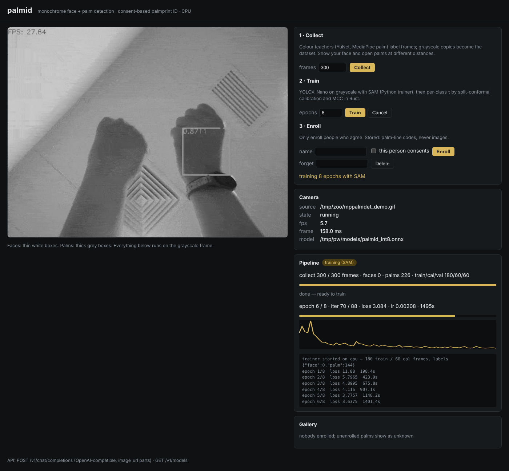

# palmid

Monochrome laptop-camera **face + palm detection** and **consent-based palmprint identification**, on CPU.
This is the Rust runtime of the `VG360_PalmID_Mono_Webcam` notebook; training stays in the notebook.

```
 notebook (Python, Colab)                          palmid (Rust, this repo)
 ───────────────────────                           ────────────────────────
 colour webcam frames                              grayscale frames (ffmpeg / images / API)
   → YuNet face + MediaPipe palm (teachers)          → CLAHE + letterbox (bit-exact with OpenCV)
   → grayscale copies                                → YOLOX-Nano INT8 (onnxruntime)
   → YOLOX-Nano trained with SAM                     → per-class conformal τ, NMS
   → INT8 ONNX + per-class τ  ───────────────────►   → palm ROI → CompCode → open-set ID
     palmid_int8.onnx, palmid_model.json             → OpenAI-compatible API, live MJPEG view
```

Why a student model: MediaPipe's palm detector depends on skin colour. On grayscale it found 5 palms
where colour gave 54 (same 70 frames), and CLAHE did not help. The notebook labels colour frames with
the teachers and trains YOLOX-Nano on the grayscale copies, so runtime is fully monochrome.

## What it does and does not do

* **Faces:** detection only. No face recognition.
* **Palms:** identification of **enrolled people only**, each enrolled with explicit consent
  (`--consent yes`). Anyone else is reported as `unknown`. The gallery stores CompCode orientation
  codes (one digit 0–5 per cell), never images. `palmid delete --name X` removes a person.
* **Resolution:** a webcam resolves palm principal lines and creases, **not friction ridges**
  (those need ~500 dpi contact scanners). Matching uses CompCode (6-orientation Gabor competitive code).
* **Safety gate:** if a person's genuine distances are not clearly below chance (shuffled-code
  distance − 0.06), the texture wasn't resolved and any threshold would accept everyone, so enrollment
  is **refused** with a "move closer / more light" message.
* **No liveness check:** a printed palm photo could be accepted. Don't use this for access control as is.
* **Accuracy on real palms is unmeasured.** Public palmprint datasets (Tongji, IITD, MPD) weren't
  reachable from the build environment. The tests check mechanics and OpenCV parity, not biometric accuracy.

## Build

```bash
pip install onnxruntime        # provides libonnxruntime.so (loaded at run time)
export ORT_DYLIB_PATH=$(python -c "import onnxruntime,os,glob;print(glob.glob(os.path.dirname(onnxruntime.__file__)+'/capi/libonnxruntime.so*')[0])")
cargo build --release
```

Webcam capture uses an `ffmpeg` subprocess (v4l2 on Linux, avfoundation on macOS, dshow on Windows).
No OpenCV needed.

## Use

Train in the notebook (`notebooks/VG360_PalmID_Mono_Webcam.ipynb`), then copy
`palmid_int8.onnx` and `palmid_model.json` into `models/`.

```bash
B=target/release/palmid
$B enroll --name dhanesh --consent yes --source webcam          # hold one open palm 25–40 cm away
$B list
$B live --source webcam --port 8361                             # open http://localhost:8361/
$B identify --source webcam --max-frames 100
$B serve --port 8361                                            # API only
$B delete --name dhanesh
$B detect some.jpg other.png
$B calibrate --data path/to/yolo_data --split cal               # re-derive per-class τ, rewrites --meta
$B eval --data path/to/yolo_data --split val                    # frame-level MCC per class
```

`--source` accepts `webcam`, `webcam:/dev/video2`, a video file/URL, or a folder of images.

### API (OpenAI-compatible)

```bash
curl -s localhost:8361/v1/chat/completions -H 'content-type: application/json' -d '{
  "model": "palmid-mono-yolox-nano-int8",
  "messages": [{"role": "user", "content": [
    {"type": "image_url", "image_url": {"url": "data:image/jpeg;base64,'"$(base64 -w0 frame.jpg)"'"}}]}]}'
```

`choices[0].message.content` is a JSON string: per object `class`, `score`, `bbox`, and for palms
`identity` (`name` / `unknown` / `pending` until 3 of the last 6 frames agree) plus per-person distances.

## Web app (Topcoat): training and inference with live status

`web/` is a [Topcoat](https://github.com/tokio-rs/topcoat) app that runs the whole pipeline in one
page. The camera feed and every status panel update live over Topcoat's runtime WebSocket.



*(The boxes and FPS text inside this frame are baked into the opencv_zoo demo clip used as a stand-in camera.)*

```
 browser ◄──── live regions (WebSocket) ──── palmid-web (Rust, Topcoat 0.12)
   │  buttons = Topcoat procedures             │
   │                                            ├─ camera thread: ffmpeg → RGB frame → mode
   ▼                                            │    infer   → INT8 student + palmprint ID
 1 Collect ─► colour teachers in Rust ─────────►│    collect → YuNet + MediaPipe palm (Rust/ort) → gray PNG + YOLO labels
 2 Train   ─► supervised Python child ─────────►│    trainer/train_student.py (SAM) → JSON progress lines → live loss chart
             (YOLOX needs PyTorch)              │    → Rust: Mondrian split-conformal τ + MCC on val → hot-swap model
 3 Enroll  ─► consent checkbox required ───────►│    enroll  → 40 palm codes → conformal τ + chance gate
                                                └─ POST /v1/chat/completions (same live model)
```

What updates live: the monochrome feed (about 10 fps to the browser) with face and palm boxes; camera
fps and frame time; per-frame detections and identities; collection progress with per-split counts;
trainer epoch, iteration, loss, learning rate and a loss chart; the trainer log; per-class τ and MCC
after calibration; enrollment progress and the gallery.

The pipeline phase is a checked state machine (`lean_mirror::can_transition`, Lean §6). The live
detector is replaced only on **Calibrating → Ready** (`swap_requires_calibrated`), so a model whose
thresholds weren't calibrated never serves.

### Run it

```bash
# Rust ≥ 1.99 for Topcoat 0.12; onnxruntime + ffmpeg as above
cargo install topcoat-cli --version 0.12.1 --locked
pip install -r trainer/requirements.txt        # torch, onnx, onnxruntime, opencv for the trainer
topcoat asset bundle -p palmid-web --release   # Topcoat's browser runtime
cargo run -p palmid-web --release              # http://127.0.0.1:3000
```

| env | default | |
|---|---|---|
| `PALMID_SOURCE` | `webcam` | `webcam`, `webcam:/dev/video2`, a video file/URL, or an image folder |
| `PALMID_WORK` | `palmid_work` | dataset, models, gallery |
| `PALMID_PYTHON` / `PALMID_TRAINER` | `python3` / `trainer/train_student.py` | training job |
| `PALMID_YOLOX`, `PALMID_YOLOX_WEIGHTS` | `~/.cache/palmid/…` | cloned / downloaded on first training run |
| `PALMID_THREADS` | `4` | onnxruntime and torch threads |
| `HOST` / `PORT` | `127.0.0.1` / `3000` | Topcoat |

Teacher models (YuNet, MediaPipe palm) download from opencv_zoo on the first **Collect**.
Collection splits frames in interleaved 10-frame blocks (6 train : 2 cal : 2 val), so every split
covers the whole session. A plain time split once left validation with no palms.

The web UI has no login. Keep it bound to `127.0.0.1` (the default) or put it behind authentication
before exposing it, because it can enroll and delete people.

## Formal guarantees and tests

`lean/PalmID.lean`: 20 theorems, Lean 4.31, kernel only (Nat + `omega`, no Mathlib, no `sorry`):

| § | Theorems | Used by |
|---|---|---|
| 1 | `angDist_symm`, `angDist_self`, `angDist_le_three`, `total_le` | CompCode distance ∈ [0,1] |
| 2 | `accept_monotone`, `min_accept`, `closerRel_irrefl` | open-set accept / best-match ranking |
| 3 | `conformal_feasible`, `conformal_tight` | per-person and per-class τ need ≥ 29 calibration samples at α = 1/30 |
| 4 | `step_bounded`, `step_lipschitz`, `run_le`, `announce_needs_K_frames` | identity debounce |
| 5 | `gate_cells` | palm resolution gate |
| 6 | `swap_requires_calibrated`, `training_requires_data`, `no_skip_calibration`, `collection_waits_for_training`, `no_self_loops` | web-app job phases |

`src/lean_mirror.rs` holds the integer mirrors that the runtime calls, with exhaustive or brute-force
checks of each theorem statement.

`cargo test` runs:

| Test | Result on the reference fixtures |
|---|---|
| CLAHE vs OpenCV | bit-exact |
| letterbox (CLAHE + INTER_LINEAR + pad) vs notebook | bit-exact |
| palm ROI (CLAHE + INTER_AREA) vs notebook | bit-exact |
| Gaussian blur vs OpenCV | within ±1 grey level (0.65 % of pixels) |
| CompCode vs notebook | 99.74 % of cells identical, distance 0.0017 |
| INT8 model output vs onnxruntime-Python | identical (max abs Δ = 0) |
| decode + NMS vs notebook | identical detections |
| colour teachers vs OpenCV FaceDetectorYN / notebook palm decode | IoU 1.0000 (local; needs teacher models) |
| RGB→gray vs `cvtColor` | identical over all 2²⁴ colours |
| enrollment / identification (synthetic palm-line images) | 20/20 genuine accepted ×2, 0/20 unenrolled accepted, noise refused |

Model tests need `ORT_DYLIB_PATH`; they are skipped without it. `tests/fixtures/test_model_int8.onnx`
is a barely trained smoke-test model for parity tests only, not a usable detector. Regenerate
fixtures with `tools/make_fixtures.py`.

Training (SAM, MCC, Mondrian conformal calibration) lives in the notebook. The Rust `eval` and
`calibrate` commands re-run the MCC and conformal steps on your own labelled data.

### INT8 results depend on the CPU

The same INT8 model and input gave raw outputs up to 3.1 apart on this sandbox's Xeon and on a GitHub
runner (different onnxruntime INT8 kernels and versions). The final detections matched here, but
scores near a threshold can flip. **Run `palmid calibrate` on the deployment machine** (for example
the N100 edge box) so the per-class τ fit the kernels that will actually run. CI regenerates the
reference fixtures on the runner for the same reason.

## Measured

On a 2-vCPU Xeon sandbox, release build, 4 threads: about 25–45 ms per 640×480 frame end to end
(detection plus palm code), and the live loop ran at about 24 fps from a video file.
